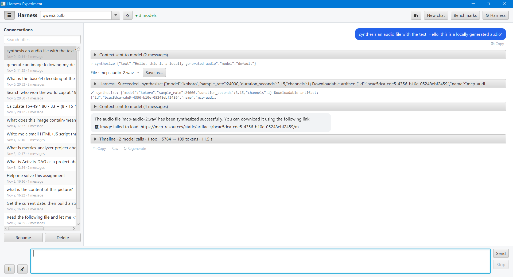
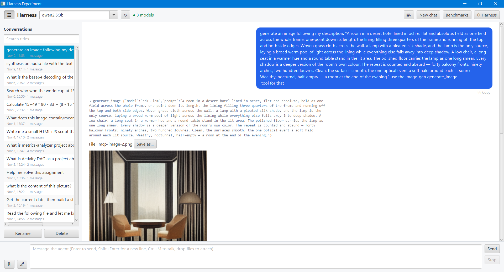
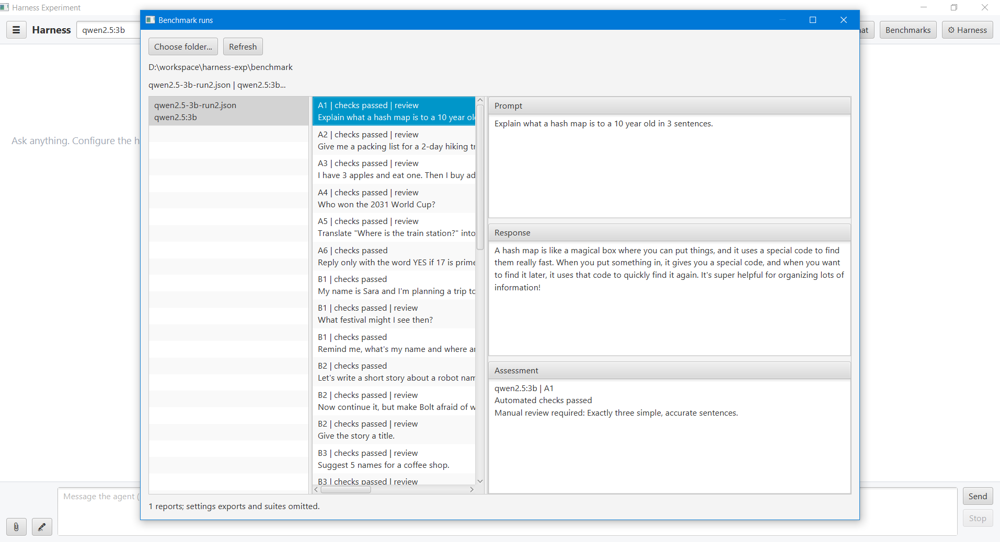

# harness-exp

Harness engineering experiment: a JavaFX desktop app that wraps local and cloud AI models (via the
[Ollama API](https://github.com/ollama4j/ollama4j), OpenAI or Anthropic) in a configurable **agent harness**.

The main window is intentionally just a ChatGPT-like chat. Everything that shapes the agent lives in a
separate **⚙ Harness** settings window, one tab per harness concern.


## Chat window

- **Copy** under every request and response, and **↻ Regenerate** under every response. Regenerate rewinds the
  conversation to that request and runs it again; later messages are discarded.
- **☰ History**: a collapsible sidebar listing saved conversations, with title search, rename (button, F2,
  double-click or right-click) and delete. Selecting one
  restores its bubbles and tool traces; new messages continue it with the full transcript as context.
  Conversations are stored with [MapDB](https://github.com/jankotek/mapdb) in `~/.harness-exp/history.db`
  (package `history`). Each record is a JSON transcript plus per-turn outcomes, and the file is transactional.
  If the file is locked by another running instance, the app falls back to in-memory history and shows a warning.
- **📚 Documents (RAG)**: a per-conversation knowledge base for large files, folders or pasted text; the button
  shows how many documents the chat has. See [RAG](#rag-documents).
- **🎤 Voice input**: talk instead of typing with the mic button or **Ctrl+M**. See [Voice input](#voice-input--transcription).
- **Markdown replies**: replies are rendered as Markdown with [MDFX](https://github.com/JPro-one/jpro-platform)
  (headings, lists, tables, and syntax-highlighted code for about 24 languages, including Java, Python, JS/TS,
  C/C++, Go, Rust, SQL, JSON, XML/HTML, YAML and shell). Single line breaks are kept, so plain-text answers and
  poems look the same as before. Each reply has a **Raw / Markdown** toggle, and **Copy** always copies the raw text.
  - **Math**: `$…$` and `\(…\)` render inline, and `$$…$$` and `\[…\]` render as display formulas. They are
    drawn locally with [JLaTeXMath](https://github.com/opencollab/jlatexmath), so nothing is fetched. Amounts like
    `$5 and $10` stay text, math inside code is left alone, `\$` is a literal dollar, and a formula that can't be
    parsed is shown as its TeX source.
  - Images are not fetched until you click **Load image** or **Allow all images**, because a remote image URL
    chosen by the model can leak data.
  - Links open in your browser only after you confirm them; only `http`, `https` and `mailto` links can be opened.
  - Both switches are in **Reply & UI**. While a reply streams it is shown as plain text, and it is rendered
    once it finishes.
- **Tool trace**: tool calls and their results are shown above the reply (toggle in **Reply & UI**).
- **Timeline**: a collapsed pane under each reply showing context size per contributor, model/tool latency, tokens
  and repairs. See [Run timeline](#run-timeline--context-compaction).


## Harness sections

| Section | What it controls | Code |
|---|---|---|
| Model | Provider (`ollama` local/cloud, `openai`, `anthropic`), base URL, API key, model, timeout, streaming, max output tokens. See [Cloud models](#cloud-models-openai--anthropic) | `llm` |
| System prompt | Template with `{{date}}`, `{{time}}`, `{{model}}`, `{{os}}`, `{{user}}` variables | `prompt` |
| Skills | Edits the skills folder (`~/.harness-exp/skills/<id>/SKILL.md`): new / save / delete / revert, plus **⟳ Refresh** to pick up outside edits or agent-created skills. Skills are injected always or only when trigger words match | `skills` folder |
| Memory | Long-term memories: backend (Markdown folder or MapDB), context/recall limits, direct explicit writes; list / search / add / edit / delete memories and copy them to the other backend. See [Memory](#memory) | `memory` |
| RAG | Per-conversation documents: automatic context on/off, embedder (Ollama embedding model or built-in offline) with a **Test** button, chunk size/overlap, passages in context, search limits, min similarity, max file size. See [RAG](#rag-documents) | `rag` |
| Context builder | Ordered `ContextContributor` pipeline (toggleable), history window, conversation compaction, pinned context, attachment limits; the preview shows estimated tokens per contributor | `context` |
| Tools + MCP | Built-in tools, enable/disable, output cap, web search provider and limits, MCP servers (stdio / streamable HTTP) with live status, test, reconnect and `mcp.json` import | `tools` |
| Agent loop | Iteration/tool-call/duration/repeat/error limits (clamped by hard ceilings in `AgentLoopLimits`) and `HookPoint`s | `agent` |
| Guardrails | Input/tool-call/output guardrails: length limit, blocked terms, secret redaction | `guardrails` |
| Human approval | Never / risky tools / all tools, always-allowed list, timeout (denies and closes the dialog). Tools that run agent-written code (`create_tool`, dynamic tools), rewrite its instructions (`create_skill`), make API requests (`http_request`), and `DANGEROUS` tools need approval on **every** call, whatever the policy, and can't be "always allowed" | `approval` |
| Reply | Markdown or raw text, plus **agentic UI**: the model emits ```` ```ui ```` JSON blocks rendered as live JavaFX components; image permission and tool trace, thinking, sent-context and run-timeline toggles | `reply` |
| Speech | Voice input on/off, send right after dictation, transcribe audio attachments, language, max recording length, model download | `speech` |
| Storage | External locations for the skills folder, dynamic tools folder, MapDB history file, local models folder, memory folder, memory DB and RAG index folder (browse or type; blank = default). Applies after restart | `storage` |

### Screenshots

<details>
<summary>Model</summary>


</details>

<details>
<summary>System prompt</summary>


</details>

<details>
<summary>Skills</summary>


</details>

<details>
<summary>Memory</summary>


</details>

<details>
<summary>RAG</summary>


</details>

<details>
<summary>Context builder</summary>


</details>

<details>
<summary>Tools &amp; MCP</summary>


</details>

<details>
<summary>Agent loop</summary>


</details>

<details>
<summary>Guardrails</summary>


</details>

<details>
<summary>Human approval</summary>


</details>

<details>
<summary>Reply &amp; agentic UI</summary>


</details>

<details>
<summary>Speech</summary>


</details>

<details>
<summary>Storage</summary>


</details>

## Architecture

```
user msg -> INPUT guardrails -> loop {
   ContextBuilder (contributors) -> ModelProvider.chat
   -> tool call?  no  -> OUTPUT guardrails -> reply renderer (text / agentic UI)
                  yes -> TOOL_CALL guardrails -> human approval -> Tool.execute -> result back to model
} bounded by AgentLoopLimits, with hooks at every HookPoint
```

Extension points are Guice multibinders in `config/AppModule`: `ModelProvider`, `Tool`, `Guardrail`,
`ContextContributor`, `AgentHook`, plus `McpToolSource` and `ApprovalGateway` bindings.

Protocols (provider-agnostic, plain text):

- Tool call: ```` ```tool_call {"name": "read_file", "arguments": {"path": "README.md"}} ``` ````
- Generated UI: ```` ```ui {"type": "card", "text": "Title", "children": [{"type": "button", "text": "Go", "action": "message sent back"}]} ``` ````
  Supported types: column, row, card, heading, text, button, list, table, progress, badge, separator.

MCP servers are connected by `tools/mcp/McpClientManager` (see [MCP servers](#mcp-servers)).

Malformed `tool_call` blocks are not shown as answers; the loop sends the parse problem back to the model
so it can retry (bounded by the iteration limit).

## System tools

| Tool | Risk | What it does |
|---|---|---|
| `file_discovery` | sensitive | Lists a directory, finds filenames with a glob, or searches literal UTF-8 text with line-numbered snippets. Explicit root directory, bounded traversal/output, no symlink following |
| `http_request` | sensitive, approval every call | Calls HTTP(S) APIs (including localhost) with a method, headers and optional UTF-8 body. Returns status, selected headers and bounded text. No redirect following or automatic result retries |
| `write_file` | sensitive | Writes (or appends with `append: true`) UTF-8 `content` to `path`, creating parent folders. Use `artifact: true` and a plain filename for a downloadable conversation file (no append). Up to 1,000,000 characters |
| `write_binary_file` | sensitive | Saves binary data from exactly one of `base64` or `sourcePath` (an existing local file). Defaults to a downloadable artifact; `artifact: false` writes to an ordinary path. No append; up to 20 MiB per file |
| `run_native_shell` | dangerous | Runs `command` in PowerShell (Windows) or bash/sh (elsewhere), optional `workingDirectory` and `timeoutSeconds` (default 60, max 600). Returns exit code and combined output (20KB cap) |
| `run_python_code` | dangerous | Runs `code` with `python3`/`python`/`py`; same options and limits as the shell tool |
| `ask_user_for_decision` | safe | Opens a window with a `question`, optional `options` and optional `inputLabel`. Exactly two options without input show two large buttons; no options shows only the labelled input; anything else shows a radio list with the optional input |

Dangerous tools need approval on every call and run **without a sandbox**; timeouts kill the process tree.
PowerShell output is UTF-8 and runs with `$ErrorActionPreference = 'Stop'`, so a cmdlet error cannot be
hidden by a later successful command. Invalid timeout or working-directory argument types return errors.

### File discovery

Use `file_discovery` instead of shell commands for read-only directory listing, filename discovery and content
search. It uses the same sensitive-tool approval policy as `read_file`; it does not introduce a filesystem sandbox.
The `path` is an explicit root directory, absolute or relative to the application's working directory:

```json
{"path":"C:\\Documents","operation":"list"}
{"path":"C:\\Documents","operation":"find","glob":"*.pdf","maxDepth":5}
{"path":"C:\\Documents","operation":"search","glob":"*.txt","query":"invoice","caseSensitive":false}
```

`list` inspects immediate children only. `find` and `search` default to depth 5 (maximum 32). Globs match a filename
or a relative path using the host filesystem's glob syntax. Content queries are **literal**, not regex.
Hidden entries are excluded unless `includeHidden: true`; symbolic links are not followed.
Results include absolute paths and either metadata or line numbers and snippets. Use `read_file` for more context.

Each call stops at 100 results by default (`maxResults`, maximum 500), 10,000 visited entries, a cooperative
10-second scan budget, or approximately 20,000 characters of result entries. Content search skips files larger than
256 KiB, invalid UTF-8 and NUL-containing files, and reads at most 8 MiB total (plus a byte to detect growth).
`skippedFiles`, `incomplete`, `stopReason` and `errors` distinguish an empty result from a limited or failed search.
Filesystem errors return a failed tool result with any partial matches. Narrow the root/glob to inspect omitted files.
The normal tool-output cap still applies when results are sent to the model.

### HTTP API requests

`http_request` is for explicitly requested API interactions, not a replacement for the robots-aware web research
tools. It supports `GET`, `HEAD`, `POST`, `PUT`, `PATCH`, `DELETE` and `OPTIONS`, including local/private-network APIs.
**Every call needs approval**, even with the Never policy or an always-allowed entry: any method can disclose data
or affect remote state. Review the destination, headers and body before approving.

```json
{"url":"http://127.0.0.1:8080/health"}
{"url":"https://api.example.com/items","method":"POST","headers":{"Content-Type":"application/json"},"body":"{\"name\":\"example\"}","bearerTokenEnv":"EXAMPLE_API_TOKEN"}
```

`bearerTokenEnv` reads a bearer token from the harness process's environment at execution time; the arguments contain
only the variable name. Missing variables fail the call. Prefer this over putting secrets in prompts or headers.
The tool redacts that token if it is echoed verbatim in the returned text or selected response headers; this is not
a guarantee against encoded or transformed secrets returned by a server.

Request bodies are UTF-8 strings up to 1 MB; GET/HEAD reject bodies. The total request timeout defaults to 30 seconds
(`timeoutSeconds`, 1–120), including receiving the response body. Text responses default to 16 KiB
(`maxResponseBytes`, maximum 64 KiB); results explicitly report truncation. JSON, XML and text media types are
supported; binary downloads are not implemented in this tool. Response character sets are honored, defaulting to UTF-8.
Only Content-Type, Location, Retry-After, ETag and Last-Modified response headers are returned, not cookies.
TLS verification stays enabled, URLs cannot embed credentials, and transport/framing headers cannot be overridden.
There is no cookie jar, redirect following or automatic retry of results. Non-2xx statuses return failed tool results
with the response details. After cancellation or a timeout, **remote state is unknown**: do not blindly retry mutations.

### Downloadable response files

Ask, for example, **"Write me a story in a .txt file"** or **"Give me this report as a .md file"**.
With `write_file` enabled, its instructions tell the model to create an artifact using
`{"path":"story.txt","content":"Once upon a time…","artifact":true}`. The normal sensitive-tool approval
policy still applies. A successful write shows a **Save as…** button in the chat, even with tool traces hidden.
The button also works after reopening a saved conversation; it copies the file to a location you choose.

Artifacts live in `<history database path>.artifacts`, separated by conversation and file ID, so storage
overrides isolate them too. Deleting a conversation deletes its managed files, **not** copies saved elsewhere.
Artifact paths must be plain filenames; ordinary `write_file` calls without `artifact: true` keep their
existing filesystem behavior and are not deleted with the conversation. Like other tool use, a small model
may need a reminder to call `write_file` rather than just describe a file.

For images, audio and other binary files, use **`write_binary_file`**, not the UTF-8 text writer:
`{"path":"image.png","base64":"<standard Base64 bytes>","artifact":true}` or
`{"path":"audio.wav","sourcePath":"<existing local file>","artifact":true}`.
The local-file option copies the bytes without changing the source and avoids passing large Base64 through the
model. Input validation rejects malformed Base64, data-URL prefixes, ambiguous sources and files over 20 MiB.
Saving bytes does not convert formats: the extension should match the supplied data.

Inline MCP **image**, **audio** and **binary resource (`blob`)** content is automatically preserved as conversation
artifacts after a successful tool call. The chat shows the same **Save as…** buttons, while the model receives
compact file references instead of binary payloads. Known MIME types get matching extensions; unknown types use
`.bin`. Capture failures are reported as tool failures, and MCP error results are not published as files.
MCP `resource_link` blocks and URLs are not fetched automatically; a server-provided filesystem path can be
imported only if it refers to a file accessible on this machine. All managed binary copies share the same
conversation-deletion behavior. The binary writer retains sensitive-tool approval; automatic MCP capture
uses the existing MCP tool's approval policy.

For example, a local text-to-speech MCP server's `synthesize` tool returns WAV audio. The harness saves it as
`mcp-audio-2.wav` and shows an inline play/stop button alongside **Save as…**:



An image-generation MCP server's `generate_image` tool works the same way. The PNG becomes `mcp-image-2.png`, which
is previewed inline beneath the file row and can also be saved with **Save as…**:



Artifacts are previewed inline from the conversation's local artifacts folder, so nothing is downloaded elsewhere
until you choose **Save as…**:

- **Images** (PNG, JPEG, GIF, BMP) show as thumbnails; click one to open it at full size.
- **Audio** (WAV, MP3, M4A, AAC, AIFF) gets a ▶ play/stop button.
- **Text files** up to 256 KiB get a collapsed **Preview** pane.

If the reply's Markdown names an artifact image from the same conversation (for example
``), the image is shown inline. It isn't fetched from anywhere, so it doesn't need the
**Allow all images** permission. Other formats only offer **Save as…**.

## Dynamic tools (agent-built, sensitive)

The agent can write its own tools with the built-in `create_tool` tool (`tools/dynamic`):

1. The model sends a `tool_call` for `create_tool` (`name`, `description`, `argumentsHint`) and puts the Java source
   in a ```` ```java ```` block in the same reply, or passes it as `sourceCode`.
2. The source must have one public class that implements
   `net.talaatharb.harness.tools.dynamic.DynamicTool` (`String execute(Map<String, Object> arguments)`).
   `DynamicTool` and `java.util.*` are imported automatically.
3. The `JavaCompiler` API compiles the source in memory. The classes are loaded in a dedicated
   `DynamicToolClassLoader` (one per tool), and the new tool is added to the tool list immediately.
4. Only tools that compile and load successfully are saved, as JSON, to `~/.harness-exp/dynamic-tools/<name>.json`.
   They are reloaded at startup. The Tools settings section lets you view their source and delete them.

Limits are in `DynamicToolLimits`: name pattern, source size, maximum tool count, and an execution timeout.
`create_tool` and every dynamic tool are SENSITIVE and declare `alwaysRequiresApproval()`. You are asked before
**every** call, even with the "Never" policy or an "always allow" entry, and the approval dialog shows the source.
**Dynamic code runs in-process without a sandbox.** Only approve code you have read.
The app needs a JDK. The jpackage release runtime includes `jdk.compiler`.

## Skills

Skills are stored as files, one folder per skill, following the common `SKILL.md` layout:

```
~/.harness-exp/skills/
  code-reviewer/SKILL.md
  summarizer/SKILL.md
```

```markdown
---
name: "Code reviewer"
description: "Reviews code snippets"
triggers: ["review","code"]   # or "review, code", or a "- item" list; empty = always injected
enabled: true
---

When asked to review code, list bugs first, then risks, then style nits.
```

- On first start the folder is seeded with the bundled defaults (`src/main/resources/.../skills/defaults`).
  Skills from older `settings.json` files are moved into the folder once.
- The folder is read at startup. Use **⟳ Refresh** in the Skills section to re-read it after editing files by hand.
  Files that can't be read are skipped and listed there.
- The agent can add or update skills with the `create_skill` tool (`name`, `description`, `triggers`,
  `instructions`). A skill with the same name is replaced. The tool is SENSITIVE and needs approval on every call.

## Attachments

Attach files with **📎**, by dropping them on the window, or by pasting copied files (Ctrl+V). They appear as chips
above the input box (✕ removes one), and you can send a message with only attachments. Files are loaded in package
`attachments` and stored with the message, so they show up again when you reopen a conversation or regenerate a
reply.

| Type | Extensions | Sent to the model as |
|---|---|---|
| Markdown / text | md, markdown, txt, log, csv, json, yaml, yml, xml | Text inside `<attachment name=… type=…>` |
| PDF | pdf | Text extracted with PDFBox. Scanned PDFs with no text layer are rejected |
| Pictures | png, jpg, jpeg, gif, bmp, webp | Images in the model request. You need a vision model, such as `llava`, `qwen2.5vl` or `gemma3` on Ollama, or GPT-4o / Claude in the cloud. Anthropic only accepts png, jpg, gif and webp |
| Audio | mp3, wav, m4a, aac, aif(f), ogg, flac | The speech transcript (made locally with Whistle, see [Voice input](#voice-input--transcription)) inside `<attachment … content="speech transcript">`. WAV/AIFF work out of the box; other formats need `ffmpeg`. If transcription is off or fails, the model gets a note only. You can play the file in the chat with ▶ |

The limits are set in the **Context builder** section: files per message, MB per file, and characters of text kept
per file (longer text is cut). Attachment text goes through the input guardrails, so blocked terms block the message,
but the message-length limit doesn't apply to attachments. Click a chip or thumbnail to view the file's text or
the full-size image.


## Voice input & transcription

Speech to text runs **on your machine** with [Whistle](https://huggingface.co/Cactus-Compute/whistle) by Cactus
Compute (Apache 2.0), following [stt-tts](https://github.com/TalaatHarb/stt-tts) (package `speech`). The 16.9 MB model
and the prebuilt `cactus` runtime (`cactus.exe` on Windows) for your OS (Windows x64/arm64, macOS arm64, Linux
x64/arm64/armv7/riscv64/mipsel) are downloaded from Hugging Face on first use, or with **Download model now** in the
Speech section, into `<models folder>/whistle` (default `~/.harness-exp/models`). The runtime comes from the pinned
release **4.1.0** of [Cactus-Compute/cactus](https://huggingface.co/Cactus-Compute/cactus) (tag `v4.1.0`,
`releases/4.1.0/<platform>/`) and is rejected unless its SHA-256 matches that release's manifest. It is stored in
`whistle/cactus-4.1.0/<platform>/`, so an older `needle` engine folder can be deleted. No audio is sent to a cloud
service.

- **Talk instead of typing**: click **🎤** or press **Ctrl+M** anywhere in the window to start recording, then press
  it again to stop (**Esc** cancels). The status line shows the time and input level. The transcript is inserted at
  the cursor so you can edit it, or sent right away if "Send the message right after dictation" is on. Recording
  stops automatically after the configured maximum.
- **Audio attachments** are transcribed when attached; the chip shows "transcribed" and clicking it shows the text.
- Languages: auto-detect, English, German, French, Spanish, Italian, Dutch, Polish.
- WAV and AIFF are decoded in Java. MP3, M4A, OGG, FLAC and AAC are converted with `ffmpeg` on the PATH (or
  `-Dharness.ffmpeg=<path>`); without it the file is attached without a transcript and a warning is shown.
- `-Dharness.hf.endpoint=<url>` downloads from a Hugging Face mirror instead.

## Export / import

**Export…** and **Import…** in the Harness window move the whole setup between machines as a single JSON file
(`{"format":"harness-exp/settings","version":1,…}`, class `config.SettingsTransfer`).

- **Export** writes the settings as currently shown in the window, including unsaved edits: model, system prompt,
  context, tools and MCP, agent loop, guardrails, approval, reply and storage. You can also include the skills
  folder, the dynamic tools' source code and the memories (from the backend selected in the Memory tab). The API key and MCP env/header values are left out unless you
  tick it. `${VAR}` references are kept, since they aren't secrets.
- **Import** accepts an export or a plain `settings.json`, and applies immediately. Each option can be ticked or
  unticked:
  - keep your current API key (on by default);
  - keep your current storage folders (on by default);
  - import skills (same-name skills are replaced);
  - import dynamic tools. This is off by default because the tools are compiled and run as code;
  - import memories into the memory backend in use after the import (same-id memories are replaced).

  Items that fail are listed in the import report and the rest are still imported.

## Memory

Long-term memory that persists across conversations (package `memory`). Two backends are available; pick one in the
**Memory** tab:

- **Markdown** (default): one `<id>.md` file per memory in the memory folder. Each file has a small front matter block
  (`tags`, `source`, `created`, `updated`) followed by the memory text. You can edit or add files by hand; files without
  front matter are read as plain text.
- **MapDB**: entries stored in a single `memory.db` file.

Both locations are set in the **Storage** tab (default `~/.harness-exp/memory/` and `~/.harness-exp/memory.db`).

Tools for the agent:

| Tool | Risk | What it does |
|---|---|---|
| `remember` | sensitive (asks for approval under the default policy) | Saves `text` with optional `tags`, or a `facts` array of up to 20 text/object entries. Only identical text (ignoring case/whitespace) is deduplicated; shared words do not prove facts are equivalent. `replace_id` explicitly rewrites an existing memory |
| `recall` | safe | Searches memories by `query` (ranked by rare-word overlap and tags; empty query = most recent) and returns up to `limit` results with their ids |

The **memory** context stage (between skills and the tool catalog; it can be disabled in Context builder) adds up to
*N* memories relevant to the latest user message to the system prompt. It adds nothing when none match.

Simple single-sentence **"Remember that ..."** requests are routed directly through the same guarded, approved
`remember` tool by default, preserving the entire statement instead of asking the model to extract only some facts.
Disable this in **Memory** to experiment with model-driven writes. Multi-sentence requests, attachments and other
wordings still use the model; explicit writes cannot be declared completed without an actual tool attempt.
For explicit writes with no successful call, the harness supplies the failure/denial response itself.

All batch entries are validated before writing. Storage writes are **not a transaction across the batch**: on a
later failure the tool reports exactly which earlier entries were saved. Successful confirmations include saved
contents and remain available even with tool trace hidden. Storage failures are explicit, not silently redirected
to volatile memory. The old `duplicateThresholdPercent` JSON field is retained for compatibility but ignored;
use `replace_id` to correct a fact rather than relying on approximate overlap.

The **Memory** tab lists the memories (newest first) with search. You can add, edit, delete (with confirmation) and
revert memories by hand, and **Copy all to …** copies every memory to the other backend, keeping the same ids.


## RAG (documents)

Retrieval-augmented generation for material that is too large for memories or the chat (package `rag`). Unlike
memories, documents belong to **one conversation**.


- **Adding documents**: click **📚** in the chat window. You can add files (markdown, text, log, CSV, JSON, YAML, XML,
  HTML, Java, C#, Python and PDF), a folder (recursive, up to 500 files), or pasted text, or drop files onto the window. Indexing runs in the
  background with progress and **Cancel**. The agent can also add documents with `rag_add`.
- **Indexing**: text is split into overlapping chunks (default 1200 characters with a 200-character overlap), cut at
  paragraph or sentence boundaries where possible. Each chunk is embedded, and the chunks and their vectors are stored
  in an [Apache Lucene](https://lucene.apache.org/) 9 index in `~/.harness-exp/rag-index/` (the folder can be changed
  in **Storage**). Embeddings of up to 4096 dimensions are supported.
- **Embedders** (set in the **RAG** tab):
  - **Ollama** (default) uses `/api/embed` with an embedding model. Install one first:
    `ollama pull nomic-embed-text` (alternatives: `mxbai-embed-large`, `bge-m3`, `all-minilm`). The URL defaults to the
    Model tab's Ollama URL. Chat models can't produce embeddings, so the **Test** button reports an error for them.
  - **Built-in** works offline with no model. It uses a hashed bag of words, so it only matches shared words.
  - Each document records the embedder it was indexed with. After you switch embedders, documents indexed with the
    other one are skipped (the window and the context report this) until you click **Re-index**.
- **Retrieval**: a Lucene k-NN query over an HNSW vector index, using cosine similarity and filtered to the current
  conversation and embedder. It considers at least 100 candidates, so a conversation with few chunks is effectively
  searched exactly, and large collections stay fast. The **rag** context stage
  (after memory) adds the passages most relevant to the latest message, within a character budget. Passages below the
  minimum similarity are ignored.

Tools:

| Tool | Risk | What it does |
|---|---|---|
| `rag_search` | safe | Searches the conversation's documents (`query`, optional `limit`); an empty query lists them |
| `rag_add` | sensitive (asks for approval under the default policy) | Indexes `text` under a `name`, or a file given as `path` |

In the 📚 window you can:

- try searches and see each passage's similarity score;
- delete documents;
- **Copy to conversation…** to copy the selected documents (or all of them) to another saved conversation, along with
  their vectors, so nothing is re-embedded.

When you delete a conversation, its documents are deleted too, and at startup the app removes documents whose
conversation no longer exists. A new chat that only has documents is saved as soon as the 📚 window closes.

The chunk text is also indexed for keyword search. Possible improvements later: hybrid keyword and vector search,
re-ranking, and harness-wide collections.

## Web research tools

Two sensitive tools (they make outbound requests, so they ask for approval under the default policy) share one search
and page-extraction pipeline in package `web`:

| Tool | Arguments | What it does |
|---|---|---|
| `web_search_extract` | `query`, optional `maxPages` | Searches with the configured provider, fetches the best pages, and returns the result list (title, URL, snippet, date) plus readable page text with source URL, title and publication date. Nothing is stored. |
| `web_search_index` | `query`, optional `maxPages` | Same search and extraction, then adds each page to the **conversation's RAG documents** with `RagService.ingestText` (RAG's own chunking, embedding, redaction and persistence). The document name is the page title and its source is the URL; the publication date is kept as a header line in the text. Returns a summary of indexed, skipped (already indexed or duplicate) and failed pages. Read the content with `rag_search`. |

Page text is untrusted: the output tells the model to treat it as source data, not instructions. The default tool
output cap (**Max tool output**, 8000 chars) also applies to `web_search_extract`; raise it if you raise the web limits.
If search finds results but no page can be extracted, the tool returns an error with the available result list
and failure/skip reasons rather than claiming successful extraction.

**Configuration** (Harness → Tools & MCP → *Web search*, stored as `tools.web` in `settings.json`):

- **Provider**: one choice for both tools. Only free providers are implemented:
  - `duckduckgo` (default): the key-less HTML endpoint. It is unofficial; when it answers with a rate limit or bot
    challenge the search fails with a message and is not retried or evaded.
  - `searxng`: a self-hosted [SearXNG](https://docs.searxng.org/) instance. Set its **SearXNG URL** (default
    `http://localhost:8080`) and enable `json` under `search.formats` in its `settings.yml`.
  - `wikipedia`: the official MediaWiki API (no key); set the language code. Only searches Wikipedia.
    Search-result revision timestamps are modification dates, not publication dates, and are not labelled
    as "Published" in the output.
- **Limits**: results requested, pages read per call (`maxPages`, 1-10), fetch timeout, max page size, characters per
  page and per call (`web_search_extract`); `maxIndexCharsPerPage` (default 60000, settings file only) applies to
  `web_search_index`. Also in the settings file: `searchTimeoutSeconds`, `minContentChars`, `minHostDelayMillis`,
  `userAgent` and `allowPrivateHosts`.

**Good web citizenship**: pages are fetched with an identifying `User-Agent`, robots.txt is obeyed (an unreachable
robots.txt means "do not fetch"; it can be switched off in the UI), requests to the same host are spaced out, hosts on
private/loopback addresses are refused unless `allowPrivateHosts` is set, and 401/403/429/451 responses,
CAPTCHA/bot-challenge pages and non-HTML content are skipped and reported, never worked around.

**Extraction**: JSoup removes scripts, navigation, footers, forms, cookie/ad/sidebar blocks, then takes the
`article`/`main` element (or the densest text block) and keeps headings, paragraphs, lists, quotes and code. Very short
lines and repeated lines are dropped. Pages are de-duplicated by normalized URL (tracking parameters, `www.`, fragments
ignored) and by near-identical text; `web_search_index` also skips URLs already indexed in the conversation and pages
whose text matches an indexed one.

**Adding a provider**: implement `SearchProvider` (`id`, `displayName`, optional `configFields` for provider-specific
settings such as a URL, and `search`), and add one `searchProviders.addBinding()` line in `AppModule`. The settings UI
lists it and builds its fields automatically; neither tool changes.

## MCP servers

**Harness → Tools & MCP** connects to [Model Context Protocol](https://modelcontextprotocol.io) servers. Their tools
join the tool list next to the built-in and dynamic tools, and the model calls them with the same `tool_call`
block. The client is in `tools/mcp`: plain JSON-RPC 2.0, protocol `2025-06-18`, with no extra dependency.

| Transport | Command / URL | Env / headers |
|-----------|---------------|---------------|
| `STDIO` | Command line that starts the server, e.g. `npx -y @modelcontextprotocol/server-filesystem "C:\My Docs"` or `uvx mcp-server-fetch` | Environment variables for the process |
| `HTTP` (streamable HTTP) | Endpoint URL, e.g. `https://api.githubcopilot.com/mcp/` | HTTP headers, e.g. `Authorization: Bearer ${GITHUB_TOKEN}` |

- **Env / headers** are entered as `KEY=VALUE; KEY2=VALUE2`. Write `${VAR}` (or `${env:VAR}`) to read the value
  from the harness's own environment when connecting, so the secret isn't stored in `settings.json`.
- **Add / update** adds a server, or replaces the one with the same name. Select a row to edit it.
- **Apply** connects all enabled servers in the background. The *Status* column updates live, for example
  `connected · 14 tool(s) · secure-filesystem-server 1.0.0` or `failed: …`. Failures include the server's last
  stderr lines and are logged.
- **Test** connects once using the fields, or the selected row, and lists the server's tools without saving.
- **Reconnect selected** restarts a server, for example after it crashed.
- **Import mcp.json…** reads Claude Desktop (`"mcpServers"`), VS Code (`"servers"`) or similar files: `command` +
  `args` + `env`, or `url` + `headers`, and `"disabled": true`.
- **Timeouts:** *Connect timeout* (default 180 s, because `npx`/`uvx` may download the server on first use) and
  *Tool call timeout* (default 120 s; a call that times out is cancelled on the server).
- **Risk and approval** come from the server's tool annotations: `readOnlyHint` → SAFE, `destructiveHint` →
  DANGEROUS, anything else → SENSITIVE. The usual Human approval and Guardrails rules then apply.
- If two servers have a tool with the same name, the later one is renamed `<server>_<tool>`. A server that sends
  `notifications/tools/list_changed` gets its tool list refreshed.
- Servers are started only while **Enable tool calling** is on, and are stopped when the app exits, including the
  child processes started by `cmd /c npx …`.
- On Windows, commands that aren't `.exe` (`npx`, `uvx`, `.cmd`/`.bat`) are run through `cmd.exe /c`
  automatically.
- **Not supported:** the legacy HTTP+SSE transport (`GET /sse`), resources, prompts and sampling. Only tools are
  used. Use [`mcp-remote`](https://www.npmjs.com/package/mcp-remote) as a stdio bridge for old SSE-only servers.

**Test servers for the HTTP transport.** Two local JavaFX apps make convenient Streamable HTTP servers for trying
the MCP setup and binary artifacts (the screenshots in
[Downloadable response files](#downloadable-response-files) were made with them). Both servers are off by default,
listen on loopback only, and are started with the **MCP** toggle in each app:

| App | Endpoint | Headers | Useful tools |
|-----|----------|---------|--------------|
| [TalaatHarb/stt-tts](https://github.com/TalaatHarb/stt-tts) | `http://127.0.0.1:8765/mcp` | `Authorization=Bearer ${STT_TTS_MCP_TOKEN}`. Copy the token from the app's MCP settings (`mcp.token`). | `synthesize` returns WAV audio |
| [TalaatHarb/image-gen](https://github.com/TalaatHarb/image-gen) | `http://127.0.0.1:8764/mcp` | none | `list_models`, `generate_image` returns a PNG |

Download the models in each app first, and raise the *Tool call timeout* setting if a generation takes longer
than 120 s (this mostly happens on the first call, while the model loads). The audio and image they return are
saved as conversation artifacts and shown inline.

Example: an `mcp.json` you can import.

```json
{
  "mcpServers": {
    "filesystem": { "command": "npx", "args": ["-y", "@modelcontextprotocol/server-filesystem", "C:\\work"] },
    "github": { "url": "https://api.githubcopilot.com/mcp/", "headers": { "Authorization": "Bearer ${GITHUB_TOKEN}" } }
  }
}
```

## Cloud models (OpenAI / Anthropic)

Open **⚙ Harness → Model** and pick a provider. When you switch provider, the base URL changes to that provider's default (unless you typed a custom URL). Then click **Test connection & list models** and choose a model.

| Provider | Base URL (default) | API key | Notes |
|---|---|---|---|
| `ollama` | `http://localhost:11434` (Local) or `https://ollama.com` (Cloud) | Only for Ollama cloud; blank = `$OLLAMA_API_KEY` | |
| `openai` | `https://api.openai.com/v1` | Create one at <https://platform.openai.com/api-keys>; blank = `$OPENAI_API_KEY` | Chat Completions API. Also works with OpenAI-compatible servers (OpenRouter, Groq, LM Studio, vLLM, …) if you change the base URL |
| `anthropic` | `https://api.anthropic.com` | Create one at <https://console.anthropic.com/settings/keys>; blank = `$ANTHROPIC_API_KEY` | Messages API (`anthropic-version: 2023-06-01`). Uses **Max output tokens** (default 4096) |

Example with an OpenAI key:

1. Provider: `openai`. Leave the base URL as `https://api.openai.com/v1`.
2. Paste your `sk-…` key into **API key**, or leave it blank and start the app with the environment variable set:
   ```sh
   export OPENAI_API_KEY=sk-...        # PowerShell: $env:OPENAI_API_KEY = "sk-..."
   java -jar target/harness-exp-0.1.0-jar-with-dependencies.jar
   ```
3. Click **Test connection & list models**, choose a model (e.g. `gpt-4o-mini`), then click **Save & close**.

Example with an Anthropic key:

1. Provider: `anthropic`. Leave the base URL as `https://api.anthropic.com`.
2. Paste your `sk-ant-…` key, or set `ANTHROPIC_API_KEY` (PowerShell: `$env:ANTHROPIC_API_KEY = "sk-ant-..."`).
3. Click **Test connection & list models**, choose a Claude model, and adjust **Max output tokens** if replies get cut off.

Notes:

- A key typed into the field is saved in plain text in `settings.json`. Use the environment variable if you'd rather not store it, and keep `settings.json` private. **Export…** leaves the key out unless you tick it.
- Tool calling, skills, guardrails, approvals and agentic UI work the same with every provider, because the harness runs its own text-based tool protocol rather than the vendors' native tool APIs. Tool results are sent to cloud models as user messages.
- Usage is billed by the provider. The agent-loop limits in the **Agent loop** section also cap how many paid calls one message can make.
- Errors such as an invalid key (HTTP 401) or an unknown model are shown in the chat and logged.

## Future tasks

Planned, task-agnostic harness experiments (not specific to coding or any other domain):

- [ ] **Run timeline** (first version done, see [below](#run-timeline--context-compaction)): next, a timeline
  export, cost per provider/model, and timelines in benchmark reports.
- [ ] **Context compaction** (first version done): next, a real tokenizer per provider, using the model's context
  length instead of a fixed budget, and viewing/editing the stored summary.
- [ ] **Benchmark comparison**: compare runs side by side (pass rate, per-task diffs, regressions between harness
  settings or models) with optional judge-model scoring for manual-review tasks, clearly labelled as such.
- [ ] **Conversation branching**: edit an earlier message and continue from it as a new branch, keeping the
  original branch, instead of Regenerate discarding later turns.
- [ ] **Browser interaction**: planned only; see [the proposed design](#browser-interaction-plan-not-implemented).

### Browser interaction plan (not implemented)

The goal is general-purpose interaction with JavaScript-driven websites, complementing `web_search_extract`
and `http_request`, without turning the harness into a task-specific browser agent.

1. **Backend and lifecycle.** Start with an optional Playwright-backed MCP server, keeping browser dependencies out
   of the JavaFX core. Use a dedicated, visible browser context per conversation, not the user's normal browser
   profile. Initially keep sessions ephemeral; close the browser on conversation deletion, disconnect or app exit.
   Authentication is performed by the user in the browser; never expose cookies, passwords or storage tokens to
   the model. Do not promise sandboxing simply because the browser uses another process.
2. **Minimal tool contract.** Navigate/back, return a bounded accessibility snapshot, click an element, fill a field,
   select an option, scroll, and take a screenshot. Use stable element references tied to a snapshot/page revision;
   reject stale references rather than guessing which element the agent meant. Return new snapshots after actions.
   Screenshots and user-approved downloads become conversation artifacts through the existing artifact pipeline.
3. **Permissions and user control.** Review destination origins, gate navigation to private networks, and block
   `file:`/other non-web URLs. Initially require per-action approval for all interactions, because even a click or
   navigation can submit data or change state. Show the current origin and proposed action; allow manual takeover
   and Stop. Require explicit permission before uploads. Do not bypass CAPTCHAs or access restrictions.
4. **Context and limits.** Treat page text as untrusted evidence, never as harness instructions. Bound snapshot size,
   actions, tabs, downloads and navigation time. Exclude password values and sensitive fields from snapshots and
   mask them in screenshots. Cancellation stops pending automation but cannot undo an already submitted action;
   never automatically replay submissions during recovery.
5. **Delivery and acceptance checks.** First ship read-only navigation/snapshots/screenshots; then enable approved
   interactions and artifact downloads. Use local fixture sites to check dynamic pages, stale references, forms,
   cross-origin navigation, denied actions/uploads, secret masking, timeouts, cancellation and session cleanup.
   Include a check that a denied submission causes no server-side mutation and that retries do not duplicate one.

No browser tools, dependencies or browser process are added by this plan.

## Run timeline & context compaction

**Timeline.** Every agent run records a `RunTimeline` (package `trace`): each context assembly with its estimated
size per contributor (system prompt, skills, tools, memory, RAG, summary, history…), each model call with latency
and tokens, each tool call with its duration and outcome, repair requests (malformed tool calls, response contracts),
compaction, and the final status. Token counts reported by the provider (Ollama `prompt_eval_count`/`eval_count`,
OpenAI/Anthropic `usage`) are shown as-is; otherwise they are estimated at about four characters per token and
marked `~`. The timeline is redacted like other displayed text, shown collapsed under the reply, saved with the turn
in history, capped at 300 events, and can be hidden with **Reply & UI → Show run timeline**. Hooks can read the
live one via `AgentRunContext.timeline()`.

**Compaction.** Older messages used to just fall out of the history window. Now, when the part of a conversation
that hasn't been summarized exceeds the history window (messages) or the token budget (estimated), the older part
is merged into a running summary by the chat model; the most recent messages (default 6, moved back to start at a
user message where possible) stay verbatim. The model then gets the summary as an **Earlier conversation
(summary)** system section (`conversation-summary` contributor) followed by the recent messages. The full
transcript is still kept and shown; the summary is stored with the conversation, extended incrementally on later
overflows, and discarded when Regenerate rewinds into the summarized part. Text is redacted before it is sent to
the summarizer. If summarizing fails, the run continues with the plain sliding window and a notice. Configure it
in **Context builder** (on/off, token budget with 0 = message window only, messages kept, summary length).
Compaction costs an extra model call, and a summary can lose details, so the summary section tells the model to ask
when something important seems missing.

## Running

Requirements: Java 25+ (JavaFX 25 and the Markdown renderer need it), Maven, and either [Ollama](https://ollama.com) running locally or a cloud API key (ollama.com, OpenAI or Anthropic; see [Cloud models](#cloud-models-openai--anthropic)).

```sh
ollama pull qwen2.5:3b
mvn javafx:run          # run from source
mvn verify              # tests + fat jar in target/
java -jar target/harness-exp-0.1.0-jar-with-dependencies.jar
```

The Maven launcher uses the classpath for all JavaFX libraries, matching the packaged app. Keep core JavaFX
and its incubator libraries together when configuring an IDE launch; mixing the module path and classpath can
break code highlighting with an `IllegalAccessError`.

Settings are stored in `~/.harness-exp/settings.json` (override with `-Dharness.settings=<path>`).
Skills, dynamic tools, the history DB, local speech models, memories and RAG documents default to the same folder (`skills/`, `dynamic-tools/`, `history.db`, `models/`, `memory/`, `memory.db`, `rag-index/`). Each can be moved to any external location in the **Storage** section, which writes the `storage` block of settings.json. Relative paths are resolved against the settings folder and `~` is your home folder. Changes apply after a restart, and existing data is not moved. Only the default skills ship inside the jar; they are copied into an empty skills folder.

Every chat message has a **⧉ Copy** button underneath it (assistant replies copy the raw model text, including
`ui` blocks). Errors (model/tool failures, guardrail blocks, approval timeouts, malformed protocol blocks,
uncaught exceptions) are logged via SLF4J to stderr; e.g. `-Dorg.slf4j.simpleLogger.logFile=harness.log`
writes them to a file.

## Benchmark

[`benchmark/conversational-tasks.md`](benchmark/conversational-tasks.md) is a manual checklist of 38 conversational
tasks. They cover basic Q&A, multi-turn context, the system prompt, skills, tools and approval, memory, RAG,
attachments, guardrails, loop limits and robustness. Each task has pass criteria and a score sheet, so you can compare
models and harness setups.

### Automated, isolated runs

Use the console runner rather than putting live-model expectations in the normal test suite. It runs the **same
AgentLoop, tools, context contributors, guardrails and approval service** without starting JavaFX. Maven tests use
scripted providers for deterministic harness regressions; live-model runs are explicitly opt-in:

```powershell
mvn -B -q package -DskipTests
java -jar target\harness-exp-0.1.0-jar-with-dependencies.jar --benchmark conversational --model qwen2.5:3b --temperature 0 --seed 42 --output qwen-run1.json
```

Reports live in **`benchmark`** by default: that command writes `benchmark\qwen-run1.json`. Without `--output`,
a model-and-timestamp filename is generated there. An explicit output path with a directory is respected.
The existing `benchmark\qwen2.5-3b-run2.json` can be viewed without conversion.

Click **Benchmarks** in the main window to browse run reports. Select a run to see its filename, model, date,
suite and conclusion, then a turn to read the prompt, response, automated failures and manual-review criteria.
Settings exports and suite definitions are omitted from the list. **Refresh** picks up new files; **Choose folder**
opens another report directory. The viewer is read-only and never executes model-generated UI or tool actions.
Manual-review text describes an assessment still needed, not a judge-model score.



`--benchmark` without a name still runs the conversational suite. To add another benchmark, save the same JSON
suite format as `benchmark\travel-suite.json`, then use `--benchmark travel`. Alternatively, `--benchmark --suite
PATH` selects any suite file; do not combine a named benchmark with `--suite`.

Add `--repeat 3` to measure consistency, `--settings exported-settings.json` to use an exported configuration, or
`--provider openai --model MODEL` / `--provider anthropic --model MODEL` for cloud runs (normal API-key environment
variables apply). `--base-url` overrides the endpoint. `--help` lists the options. Seed support is provider-specific,
not a guarantee of identical output; Anthropic does not support a seed.

Every case gets fresh storage below an automatically created temporary directory; it is deleted after the run,
including on failure. Imported **storage overrides are always discarded**. Desktop history, memories, RAG data,
external skills and dynamic tools are not loaded. Exported skills (or bundled defaults without an export) initialize the
isolated store. MCP is disabled, as are `create_tool`, `read_file` and `rag_add`. Only `remember` and `create_skill`
can be auto-approved, and only when a case explicitly lists them. This is data isolation, **not an OS sandbox**.
Exported model/context configuration still goes to the chosen provider: inspect it before running cloud tests.

[`benchmark/conversational-suite.json`](benchmark/conversational-suite.json) is a starter subset with multi-turn
conversation switches, approved/denied memory writes, a small RAG fixture and output/context checks. Use `--suite`
to select another JSON suite. Each case supports `settings` overrides, `approveTools`, an optional `document`, and
`turns` with `prompt`, `conversation`, `exact`, `contains`, `excludes`, `tools`, `savedMemories`, `memoryCount`,
`contextExcludes`, `status`, and `review`. Contains/excludes checks are case-insensitive; exact replies are trimmed
and case-sensitive. Cases are independent; named conversations within a case share memory but not documents.
Use built-in embeddings in a case override if you do not have `nomic-embed-text` installed.

The JSON report records effective settings without the API key, replies, tool outcomes, iterations, latency and
check failures. Known credential patterns are redacted. **Passing automated checks is not a conversational quality
score**: translation, factuality, haiku metre and other subjective checks remain flagged for manual review.
The runner refuses to overwrite an existing report. Exit codes: `0` automated checks passed, `1` check failures,
`2` invalid configuration or execution failure. The original 0/1/2 manual scores are kept separately.
Editable forms, file/audio/vision attachments, RAG copying, desktop restart and Stop/Continue remain manual/UI
checks; the starter suite is not a claim that all 38 tasks are automated.

### Reliability controls

Known credential patterns are redacted before model context and RAG embedding calls, from new history records and
displayed text, and from conversation titles **before truncation**. Titles are sanitized even when guardrails are
disabled; old titles are sanitized when read. With secret redaction enabled, raw streamed tokens are buffered until
the response is guarded, so credentials split across token boundaries cannot briefly appear onscreen.
Stop preserves any safe partial response in history with a separate interruption notice; Continue has that context
but is not an exact provider-level stream resume.

This is best-effort pattern detection, **not a guarantee that every possible secret is recognized**. Binary images
and audio are not scanned for credentials. Previously exposed keys should be rotated: sanitizing displayed records
does not securely erase old database pages, existing indexes, backups or logs. Disabling redaction allows raw text
egress again (except titles). Do not put credentials in prompts or indexed documents.

**Reply & UI** has opt-in response contracts: exact list length, maximum bullets, or allowed exact replies separated
by `|`. Contracts apply to model-generated final answers until reset (not authoritative action confirmations)
and get at most three correction attempts, still bounded by the overall loop
limits. Generated UI is schema-validated too. These checks enforce structure, not truth or English syllable counts.
The optional **sent context inspector** shows the sanitized context actually sent, including retrieved memory and
document passages, so missing context can be distinguished from a model ignoring it.

Editable UI uses `form` containers and named `input` components (`props.name`, `props.inputType` of `text`, `date` or
`number`, optional `required`, `value` and `placeholder`). A form's `action` and submitted field values go back to
the agent; they do not themselves make bookings or execute tools. Required fields, dates, numeric values and UI
schema/size limits are checked locally. Static action buttons remain supported.

**Model** offers optional temperature and seed controls; blank preserves provider defaults. Ollama supports
non-negative temperatures and signed 32-bit seeds; OpenAI supports temperature 0..2 and 64-bit seeds where the
selected endpoint/model allows them. Anthropic supports temperature 0..1 and rejects a configured seed explicitly.
Provider restrictions still apply; a seed is not a reproducibility guarantee.

The `calculate` tool accepts `{"expression":"(2 + 3) * 4.5"}` with decimals, parentheses, unary signs and
`+`, `-`, `*`, `/`, `%` (remainder), using standard precedence. It removes every other character before
evaluation: `1a2` becomes `12`, and `$1,234.50` becomes `1234.50`. Functions, powers and scientific notation
are not supported. Invalid expressions and division by zero return explicit errors; input length, nesting
and numeric size are bounded. Division uses 34 significant digits. Its existing arithmetic operations and
exact primality checking remain available; it does not execute source code.
Having a tool available does not guarantee a model will use it. Ground factual answers with trusted RAG documents
or an appropriately configured MCP tool rather than expecting prompt instructions to cure hallucinations.

## CI / Releases

- `.github/workflows/project-build.yml`: `mvn verify` on Java 25 under Xvfb on every push/PR, including JavaFX
  smoke tests without a real display. Live-model benchmarks are not part of CI.
- `.github/workflows/release-build.yml`: on `v*` tags, builds fat jars on Java 25 for Linux/Windows/macOS and a
  Windows portable app (jpackage) and attaches them to the GitHub release.

## License

Apache 2.0, see [LICENSE](LICENSE).
