# harness-exp

Harness engineering experiment: a JavaFX desktop app that wraps local and cloud AI models (via the
[Ollama API](https://github.com/ollama4j/ollama4j), OpenAI or Anthropic) in a configurable **agent harness**.

The main window is intentionally just a ChatGPT-like chat. Everything that shapes the agent lives in a
separate **⚙ Harness** settings window, one tab per harness concern.

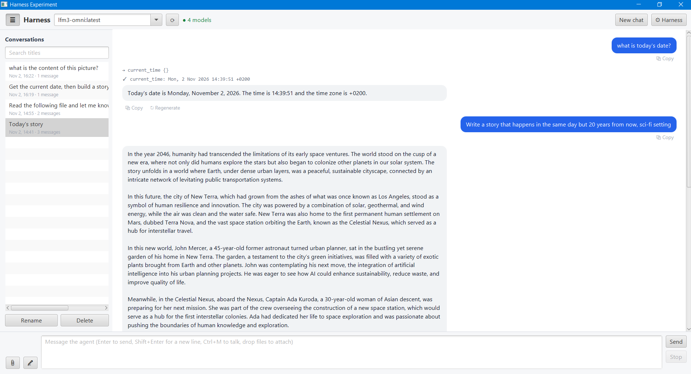

## Chat window

- **Copy** under every request and response, and **↻ Regenerate** under every response. Regenerate rewinds the
  conversation to that request and runs it again; later messages are discarded.
- **☰ History**: a collapsible sidebar listing saved conversations, with title search, rename (button, F2,
  double-click or right-click) and delete. Selecting one
  restores its bubbles and tool traces; new messages continue it with the full transcript as context.
  Conversations are stored with [MapDB](https://github.com/jankotek/mapdb) in `~/.harness-exp/history.db`
  (package `history`). Each record is a JSON transcript plus per-turn outcomes, and the file is transactional.
  If the file is locked by another running instance, the app falls back to in-memory history and shows a warning.
- **📚 Documents (RAG)**: a per-conversation knowledge base for large files, folders or pasted text; the button
  shows how many documents the chat has. See [RAG](#rag-documents).
- **🎤 Voice input**: talk instead of typing with the mic button or **Ctrl+M**. See [Voice input](#voice-input--transcription).
- **Tool trace**: tool calls and their results are shown above the reply (toggle in **Reply & UI**).

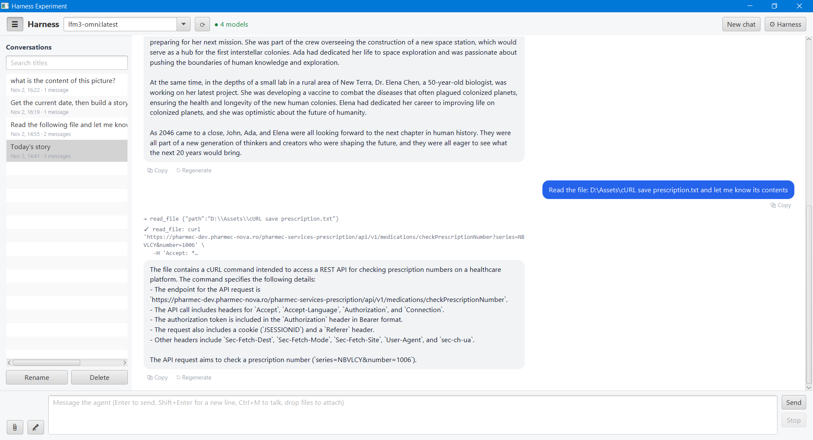

## Harness sections

| Section | What it controls | Code |
|---|---|---|
| Model | Provider (`ollama` local/cloud, `openai`, `anthropic`), base URL, API key, model, timeout, streaming, max output tokens. See [Cloud models](#cloud-models-openai--anthropic) | `llm` |
| System prompt | Template with `{{date}}`, `{{time}}`, `{{model}}`, `{{os}}`, `{{user}}` variables | `prompt` |
| Skills | Edits the skills folder (`~/.harness-exp/skills/<id>/SKILL.md`): new / save / delete / revert, plus **⟳ Refresh** to pick up outside edits or agent-created skills. Skills are injected always or only when trigger words match | `skills` folder |
| Memory | Long-term memories: backend (Markdown folder or MapDB), how many go into the context, recall limit, duplicate threshold; list / search / add / edit / delete memories and copy them to the other backend. See [Memory](#memory) | `memory` |
| RAG | Per-conversation documents: automatic context on/off, embedder (Ollama embedding model or built-in offline) with a **Test** button, chunk size/overlap, passages in context, search limits, min similarity, max file size. See [RAG](#rag-documents) | `rag` |
| Context builder | Ordered `ContextContributor` pipeline (toggleable), history window, pinned context, attachment limits | `context` |
| Tools + MCP | Built-in tools, enable/disable, output cap, MCP servers (stdio / streamable HTTP) with live status, test, reconnect and `mcp.json` import | `tools` |
| Agent loop | Iteration/tool-call/duration/repeat/error limits (clamped by hard ceilings in `AgentLoopLimits`) and `HookPoint`s | `agent` |
| Guardrails | Input/tool-call/output guardrails: length limit, blocked terms, secret redaction | `guardrails` |
| Human approval | Never / risky tools / all tools, always-allowed list, timeout (denies and closes the dialog). Tools that run agent-written code (`create_tool`, dynamic tools) or rewrite its instructions (`create_skill`) and `DANGEROUS` tools need approval on **every** call, whatever the policy, and can't be "always allowed" | `approval` |
| Reply | Plain text or **agentic UI**: the model emits ```` ```ui ```` JSON blocks rendered as live JavaFX components | `reply` |
| Speech | Voice input on/off, send right after dictation, transcribe audio attachments, language, max recording length, model download | `speech` |
| Storage | External locations for the skills folder, dynamic tools folder, MapDB history file, local models folder, memory folder, memory DB and RAG index folder (browse or type; blank = default). Applies after restart | `storage` |

### Screenshots

<details>
<summary>Model</summary>

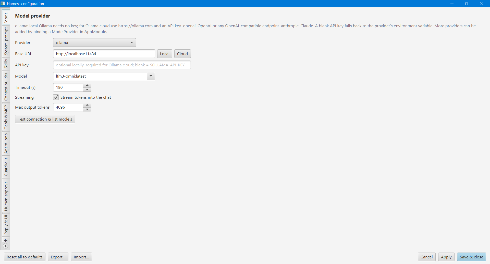
</details>

<details>
<summary>System prompt</summary>

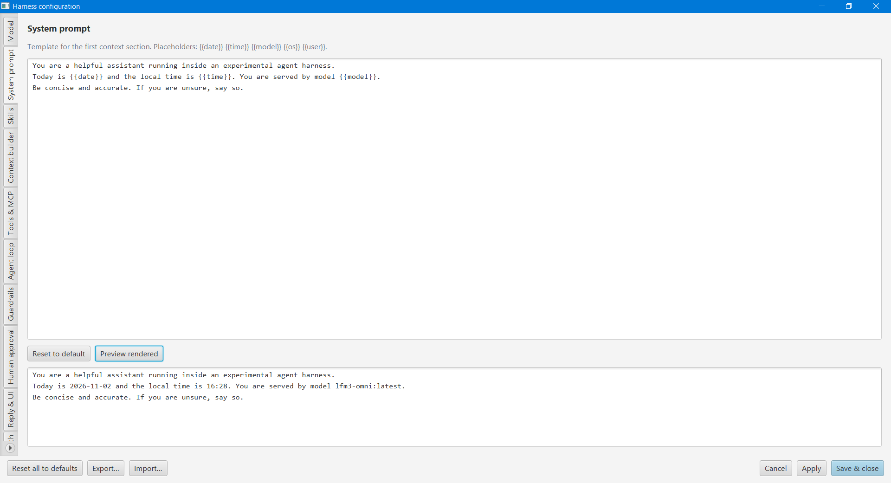
</details>

<details>
<summary>Skills</summary>

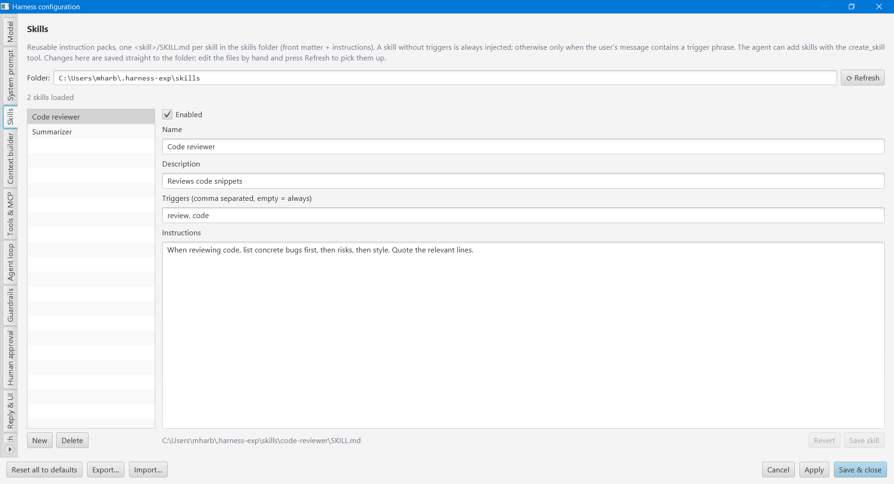
</details>

<details>
<summary>Memory</summary>

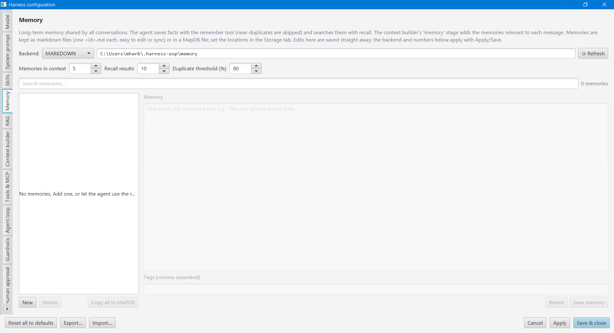
</details>

<details>
<summary>RAG</summary>

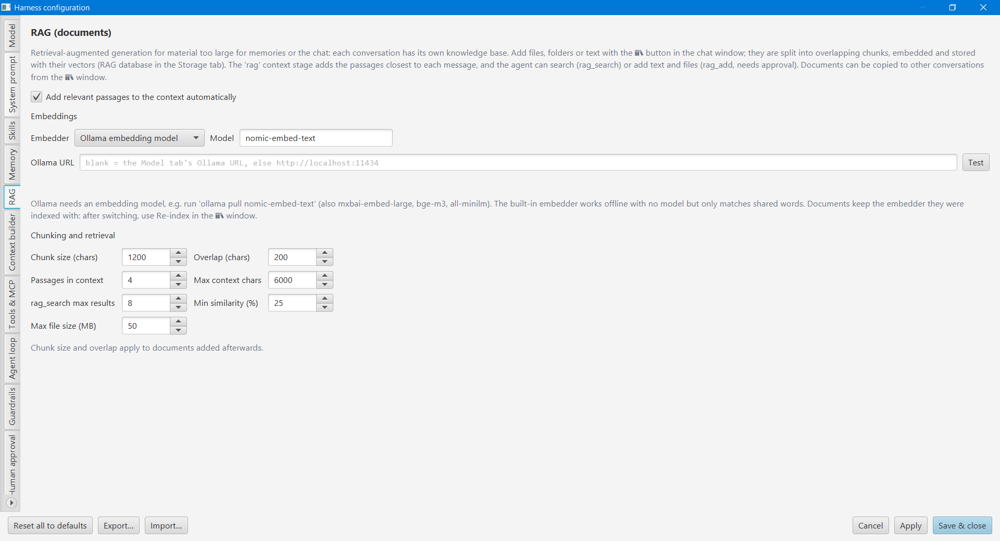
</details>

<details>
<summary>Context builder</summary>

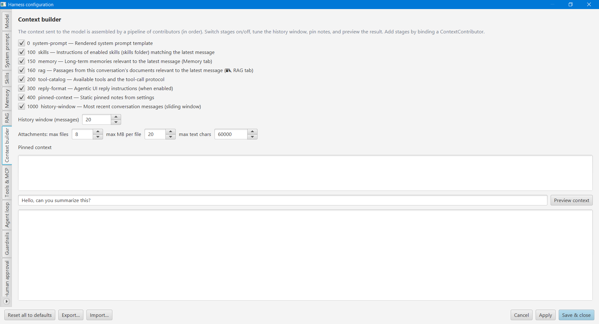
</details>

<details>
<summary>Tools &amp; MCP</summary>

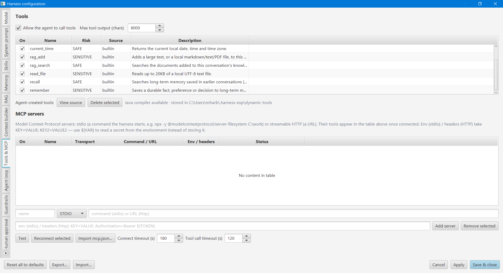
</details>

<details>
<summary>Agent loop</summary>

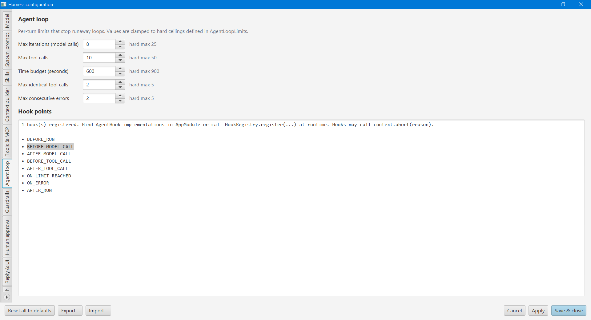
</details>

<details>
<summary>Guardrails</summary>

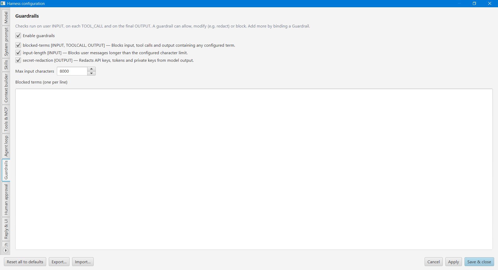
</details>

<details>
<summary>Human approval</summary>

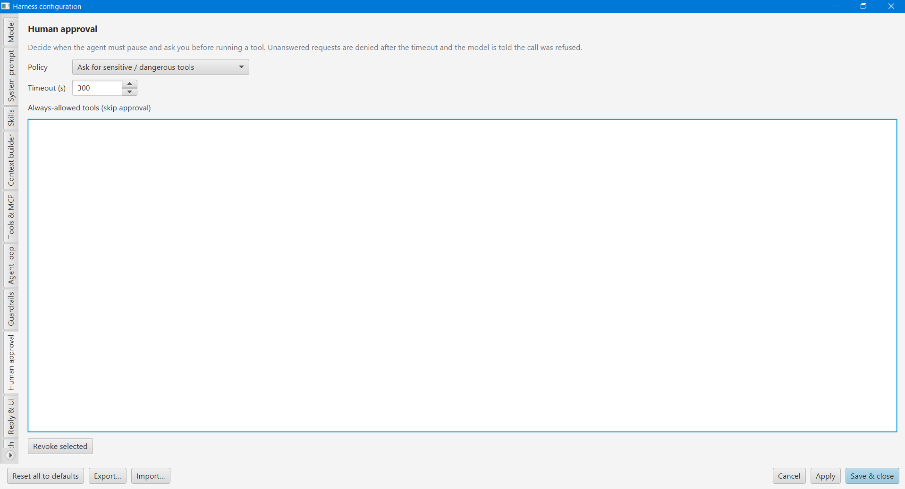
</details>

<details>
<summary>Reply &amp; agentic UI</summary>

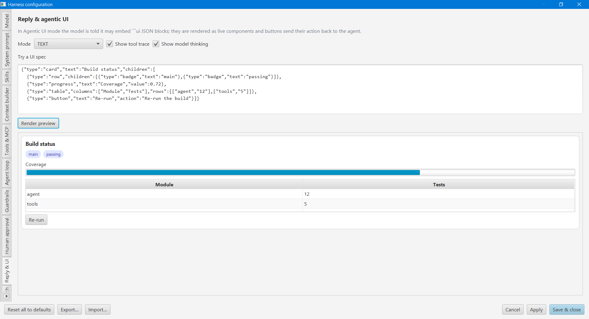
</details>

<details>
<summary>Speech</summary>

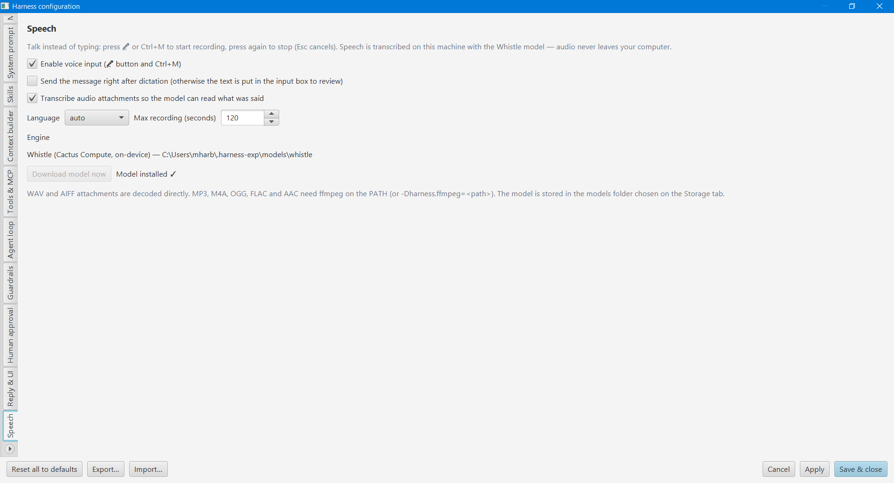
</details>

<details>
<summary>Storage</summary>

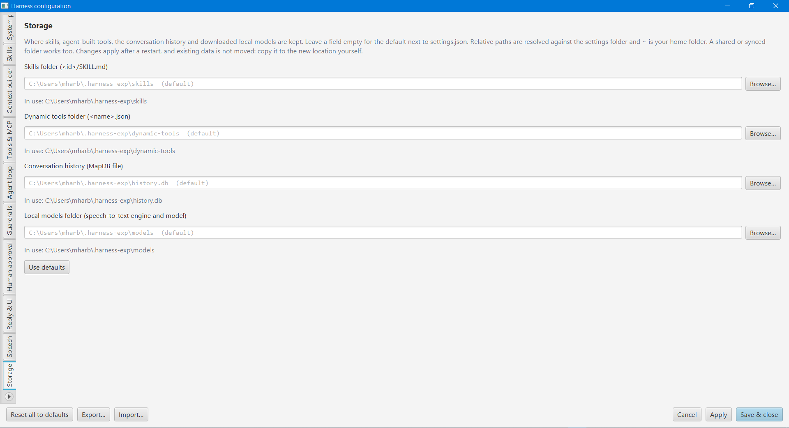
</details>

## Architecture

```
user msg -> INPUT guardrails -> loop {
   ContextBuilder (contributors) -> ModelProvider.chat
   -> tool call?  no  -> OUTPUT guardrails -> reply renderer (text / agentic UI)
                  yes -> TOOL_CALL guardrails -> human approval -> Tool.execute -> result back to model
} bounded by AgentLoopLimits, with hooks at every HookPoint
```

Extension points are Guice multibinders in `config/AppModule`: `ModelProvider`, `Tool`, `Guardrail`,
`ContextContributor`, `AgentHook`, plus `McpToolSource` and `ApprovalGateway` bindings.

Protocols (provider-agnostic, plain text):

- Tool call: ```` ```tool_call {"name": "read_file", "arguments": {"path": "README.md"}} ``` ````
- Generated UI: ```` ```ui {"type": "card", "text": "Title", "children": [{"type": "button", "text": "Go", "action": "message sent back"}]} ``` ````
  Supported types: column, row, card, heading, text, button, list, table, progress, badge, separator.

MCP servers are connected by `tools/mcp/McpClientManager` (see [MCP servers](#mcp-servers)).

Malformed `tool_call` blocks are not shown as answers; the loop sends the parse problem back to the model
so it can retry (bounded by the iteration limit).

## Dynamic tools (agent-built, sensitive)

The agent can write its own tools with the built-in `create_tool` tool (`tools/dynamic`):

1. The model sends a `tool_call` for `create_tool` (`name`, `description`, `argumentsHint`) and puts the Java source
   in a ```` ```java ```` block in the same reply, or passes it as `sourceCode`.
2. The source must have one public class that implements
   `net.talaatharb.harness.tools.dynamic.DynamicTool` (`String execute(Map<String, Object> arguments)`).
   `DynamicTool` and `java.util.*` are imported automatically.
3. The `JavaCompiler` API compiles the source in memory. The classes are loaded in a dedicated
   `DynamicToolClassLoader` (one per tool), and the new tool is added to the tool list immediately.
4. Only tools that compile and load successfully are saved, as JSON, to `~/.harness-exp/dynamic-tools/<name>.json`.
   They are reloaded at startup. The Tools settings section lets you view their source and delete them.

Limits are in `DynamicToolLimits`: name pattern, source size, maximum tool count, and an execution timeout.
`create_tool` and every dynamic tool are SENSITIVE and declare `alwaysRequiresApproval()`. You are asked before
**every** call, even with the "Never" policy or an "always allow" entry, and the approval dialog shows the source.
**Dynamic code runs in-process without a sandbox.** Only approve code you have read.
The app needs a JDK. The jpackage release runtime includes `jdk.compiler`.

## Skills

Skills are stored as files, one folder per skill, following the common `SKILL.md` layout:

```
~/.harness-exp/skills/
  code-reviewer/SKILL.md
  summarizer/SKILL.md
```

```markdown
---
name: "Code reviewer"
description: "Reviews code snippets"
triggers: ["review","code"]   # or "review, code", or a "- item" list; empty = always injected
enabled: true
---

When asked to review code, list bugs first, then risks, then style nits.
```

- On first start the folder is seeded with the bundled defaults (`src/main/resources/.../skills/defaults`).
  Skills from older `settings.json` files are moved into the folder once.
- The folder is read at startup. Use **⟳ Refresh** in the Skills section to re-read it after editing files by hand.
  Files that can't be read are skipped and listed there.
- The agent can add or update skills with the `create_skill` tool (`name`, `description`, `triggers`,
  `instructions`). A skill with the same name is replaced. The tool is SENSITIVE and needs approval on every call.

## Attachments

Attach files with **📎**, by dropping them on the window, or by pasting copied files (Ctrl+V). They appear as chips
above the input box (✕ removes one), and you can send a message with only attachments. Files are loaded in package
`attachments` and stored with the message, so they show up again when you reopen a conversation or regenerate a
reply.

| Type | Extensions | Sent to the model as |
|---|---|---|
| Markdown / text | md, markdown, txt, log, csv, json, yaml, yml, xml | Text inside `<attachment name=… type=…>` |
| PDF | pdf | Text extracted with PDFBox. Scanned PDFs with no text layer are rejected |
| Pictures | png, jpg, jpeg, gif, bmp, webp | Images in the model request. You need a vision model, such as `llava`, `qwen2.5vl` or `gemma3` on Ollama, or GPT-4o / Claude in the cloud. Anthropic only accepts png, jpg, gif and webp |
| Audio | mp3, wav, m4a, aac, aif(f), ogg, flac | The speech transcript (made locally with Whistle, see [Voice input](#voice-input--transcription)) inside `<attachment … content="speech transcript">`. WAV/AIFF work out of the box; other formats need `ffmpeg`. If transcription is off or fails, the model gets a note only. You can play the file in the chat with ▶ |

The limits are set in the **Context builder** section: files per message, MB per file, and characters of text kept
per file (longer text is cut). Attachment text goes through the input guardrails, so blocked terms block the message,
but the message-length limit doesn't apply to attachments. Click a chip or thumbnail to view the file's text or
the full-size image.

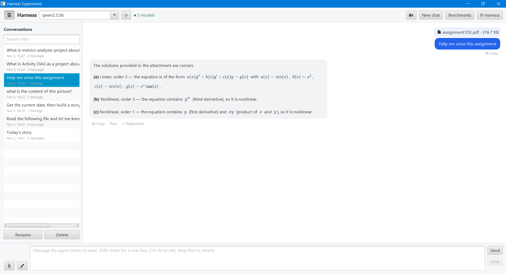

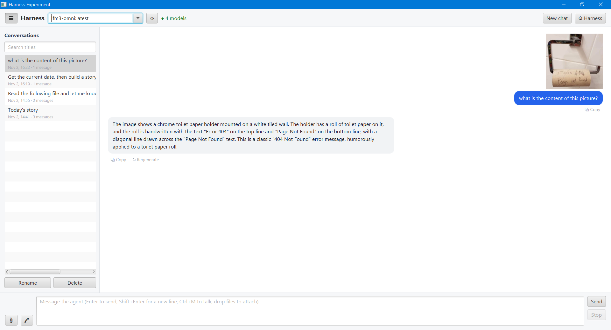

## Voice input & transcription

Speech to text runs **on your machine** with [Whistle](https://huggingface.co/Cactus-Compute/whistle) by Cactus
Compute (Apache 2.0), following [stt-tts](https://github.com/TalaatHarb/stt-tts) (package `speech`). The 16.9 MB model
and the prebuilt `needle` engine for your OS (Windows x64/arm64, macOS arm64, Linux x64/arm64/armv7/riscv64) are
downloaded from Hugging Face on first use, or with **Download model now** in the Speech section, into
`<models folder>/whistle` (default `~/.harness-exp/models`). No audio is sent to a cloud service.

- **Talk instead of typing**: click **🎤** or press **Ctrl+M** anywhere in the window to start recording, then press
  it again to stop (**Esc** cancels). The status line shows the time and input level. The transcript is inserted at
  the cursor so you can edit it, or sent right away if "Send the message right after dictation" is on. Recording
  stops automatically after the configured maximum.
- **Audio attachments** are transcribed when attached; the chip shows "transcribed" and clicking it shows the text.
- Languages: auto-detect, English, German, French, Spanish, Italian, Dutch, Polish.
- WAV and AIFF are decoded in Java. MP3, M4A, OGG, FLAC and AAC are converted with `ffmpeg` on the PATH (or
  `-Dharness.ffmpeg=<path>`); without it the file is attached without a transcript and a warning is shown.
- `-Dharness.hf.endpoint=<url>` downloads from a Hugging Face mirror instead.

## Export / import

**Export…** and **Import…** in the Harness window move the whole setup between machines as a single JSON file
(`{"format":"harness-exp/settings","version":1,…}`, class `config.SettingsTransfer`).

- **Export** writes the settings as currently shown in the window, including unsaved edits: model, system prompt,
  context, tools and MCP, agent loop, guardrails, approval, reply and storage. You can also include the skills
  folder, the dynamic tools' source code and the memories (from the backend selected in the Memory tab). The API key and MCP env/header values are left out unless you
  tick it. `${VAR}` references are kept, since they aren't secrets.
- **Import** accepts an export or a plain `settings.json`, and applies immediately. Each option can be ticked or
  unticked:
  - keep your current API key (on by default);
  - keep your current storage folders (on by default);
  - import skills (same-name skills are replaced);
  - import dynamic tools. This is off by default because the tools are compiled and run as code;
  - import memories into the memory backend in use after the import (same-id memories are replaced).

  Items that fail are listed in the import report and the rest are still imported.

## Memory

Long-term memory that persists across conversations (package `memory`). Two backends are available; pick one in the
**Memory** tab:

- **Markdown** (default): one `<id>.md` file per memory in the memory folder. Each file has a small front matter block
  (`tags`, `source`, `created`, `updated`) followed by the memory text. You can edit or add files by hand; files without
  front matter are read as plain text.
- **MapDB**: entries stored in a single `memory.db` file.

Both locations are set in the **Storage** tab (default `~/.harness-exp/memory/` and `~/.harness-exp/memory.db`).

Tools for the agent:

| Tool | Risk | What it does |
|---|---|---|
| `remember` | sensitive (asks for approval under the default policy) | Saves `text` with optional `tags`. If an existing memory already covers it (word overlap ≥ the duplicate threshold, default 80%), nothing new is added and only new tags are merged. If the new text covers an existing memory, that memory is updated instead. `replace_id` rewrites a specific memory, e.g. to correct an outdated fact |
| `recall` | safe | Searches memories by `query` (ranked by rare-word overlap and tags; empty query = most recent) and returns up to `limit` results with their ids |

The **memory** context stage (between skills and the tool catalog; it can be disabled in Context builder) adds up to
*N* memories relevant to the latest user message to the system prompt. It adds nothing when none match.

The **Memory** tab lists the memories (newest first) with search. You can add, edit, delete (with confirmation) and
revert memories by hand, and **Copy all to …** copies every memory to the other backend, keeping the same ids.


## RAG (documents)

Retrieval-augmented generation for material that is too large for memories or the chat (package `rag`). Unlike
memories, documents belong to **one conversation**.

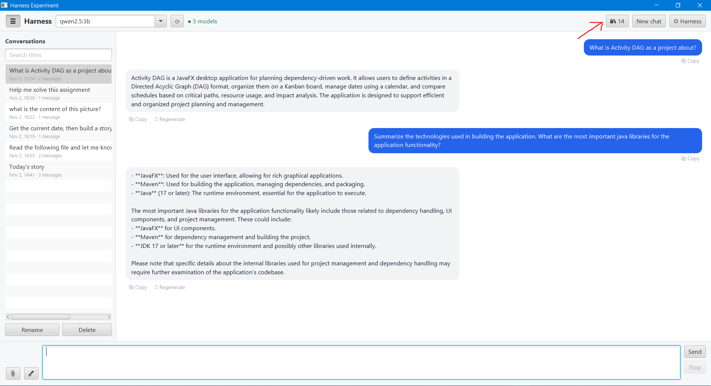

- **Adding documents**: click **📚** in the chat window. You can add files (markdown, text, log, CSV, JSON, YAML, XML,
  HTML, Java, C#, Python and PDF), a folder (recursive, up to 500 files), or pasted text, or drop files onto the window. Indexing runs in the
  background with progress and **Cancel**. The agent can also add documents with `rag_add`.
- **Indexing**: text is split into overlapping chunks (default 1200 characters with a 200-character overlap), cut at
  paragraph or sentence boundaries where possible. Each chunk is embedded, and the chunks and their vectors are stored
  in an [Apache Lucene](https://lucene.apache.org/) 9 index in `~/.harness-exp/rag-index/` (the folder can be changed
  in **Storage**). Embeddings of up to 4096 dimensions are supported.
- **Embedders** (set in the **RAG** tab):
  - **Ollama** (default) uses `/api/embed` with an embedding model. Install one first:
    `ollama pull nomic-embed-text` (alternatives: `mxbai-embed-large`, `bge-m3`, `all-minilm`). The URL defaults to the
    Model tab's Ollama URL. Chat models can't produce embeddings, so the **Test** button reports an error for them.
  - **Built-in** works offline with no model. It uses a hashed bag of words, so it only matches shared words.
  - Each document records the embedder it was indexed with. After you switch embedders, documents indexed with the
    other one are skipped (the window and the context report this) until you click **Re-index**.
- **Retrieval**: a Lucene k-NN query over an HNSW vector index, using cosine similarity and filtered to the current
  conversation and embedder. It considers at least 100 candidates, so a conversation with few chunks is effectively
  searched exactly, and large collections stay fast. The **rag** context stage
  (after memory) adds the passages most relevant to the latest message, within a character budget. Passages below the
  minimum similarity are ignored.

Tools:

| Tool | Risk | What it does |
|---|---|---|
| `rag_search` | safe | Searches the conversation's documents (`query`, optional `limit`); an empty query lists them |
| `rag_add` | sensitive (asks for approval under the default policy) | Indexes `text` under a `name`, or a file given as `path` |

In the 📚 window you can:

- try searches and see each passage's similarity score;
- delete documents;
- **Copy to conversation…** to copy the selected documents (or all of them) to another saved conversation, along with
  their vectors, so nothing is re-embedded.

When you delete a conversation, its documents are deleted too, and at startup the app removes documents whose
conversation no longer exists. A new chat that only has documents is saved as soon as the 📚 window closes.

The chunk text is also indexed for keyword search. Possible improvements later: hybrid keyword and vector search,
re-ranking, and harness-wide collections.

## MCP servers

**Harness → Tools & MCP** connects to [Model Context Protocol](https://modelcontextprotocol.io) servers. Their tools
join the tool list next to the built-in and dynamic tools, and the model calls them with the same `tool_call`
block. The client is in `tools/mcp`: plain JSON-RPC 2.0, protocol `2025-06-18`, with no extra dependency.

| Transport | Command / URL | Env / headers |
|-----------|---------------|---------------|
| `STDIO` | Command line that starts the server, e.g. `npx -y @modelcontextprotocol/server-filesystem "C:\My Docs"` or `uvx mcp-server-fetch` | Environment variables for the process |
| `HTTP` (streamable HTTP) | Endpoint URL, e.g. `https://api.githubcopilot.com/mcp/` | HTTP headers, e.g. `Authorization: Bearer ${GITHUB_TOKEN}` |

- **Env / headers** are entered as `KEY=VALUE; KEY2=VALUE2`. Write `${VAR}` (or `${env:VAR}`) to read the value
  from the harness's own environment when connecting, so the secret isn't stored in `settings.json`.
- **Add / update** adds a server, or replaces the one with the same name. Select a row to edit it.
- **Apply** connects all enabled servers in the background. The *Status* column updates live, for example
  `connected · 14 tool(s) · secure-filesystem-server 1.0.0` or `failed: …`. Failures include the server's last
  stderr lines and are logged.
- **Test** connects once using the fields, or the selected row, and lists the server's tools without saving.
- **Reconnect selected** restarts a server, for example after it crashed.
- **Import mcp.json…** reads Claude Desktop (`"mcpServers"`), VS Code (`"servers"`) or similar files: `command` +
  `args` + `env`, or `url` + `headers`, and `"disabled": true`.
- **Timeouts:** *Connect timeout* (default 180 s, because `npx`/`uvx` may download the server on first use) and
  *Tool call timeout* (default 120 s; a call that times out is cancelled on the server).
- **Risk and approval** come from the server's tool annotations: `readOnlyHint` → SAFE, `destructiveHint` →
  DANGEROUS, anything else → SENSITIVE. The usual Human approval and Guardrails rules then apply.
- If two servers have a tool with the same name, the later one is renamed `<server>_<tool>`. A server that sends
  `notifications/tools/list_changed` gets its tool list refreshed.
- Servers are started only while **Enable tool calling** is on, and are stopped when the app exits, including the
  child processes started by `cmd /c npx …`.
- On Windows, commands that aren't `.exe` (`npx`, `uvx`, `.cmd`/`.bat`) are run through `cmd.exe /c`
  automatically.
- **Not supported:** the legacy HTTP+SSE transport (`GET /sse`), resources, prompts and sampling. Only tools are
  used. Use [`mcp-remote`](https://www.npmjs.com/package/mcp-remote) as a stdio bridge for old SSE-only servers.

Example: an `mcp.json` you can import.

```json
{
  "mcpServers": {
    "filesystem": { "command": "npx", "args": ["-y", "@modelcontextprotocol/server-filesystem", "C:\\work"] },
    "github": { "url": "https://api.githubcopilot.com/mcp/", "headers": { "Authorization": "Bearer ${GITHUB_TOKEN}" } }
  }
}
```

## Cloud models (OpenAI / Anthropic)

Open **⚙ Harness → Model** and pick a provider. When you switch provider, the base URL changes to that provider's default (unless you typed a custom URL). Then click **Test connection & list models** and choose a model.

| Provider | Base URL (default) | API key | Notes |
|---|---|---|---|
| `ollama` | `http://localhost:11434` (Local) or `https://ollama.com` (Cloud) | Only for Ollama cloud; blank = `$OLLAMA_API_KEY` | |
| `openai` | `https://api.openai.com/v1` | Create one at <https://platform.openai.com/api-keys>; blank = `$OPENAI_API_KEY` | Chat Completions API. Also works with OpenAI-compatible servers (OpenRouter, Groq, LM Studio, vLLM, …) if you change the base URL |
| `anthropic` | `https://api.anthropic.com` | Create one at <https://console.anthropic.com/settings/keys>; blank = `$ANTHROPIC_API_KEY` | Messages API (`anthropic-version: 2023-06-01`). Uses **Max output tokens** (default 4096) |

Example with an OpenAI key:

1. Provider: `openai`. Leave the base URL as `https://api.openai.com/v1`.
2. Paste your `sk-…` key into **API key**, or leave it blank and start the app with the environment variable set:
   ```sh
   export OPENAI_API_KEY=sk-...        # PowerShell: $env:OPENAI_API_KEY = "sk-..."
   java -jar target/harness-exp-0.1.0-jar-with-dependencies.jar
   ```
3. Click **Test connection & list models**, choose a model (e.g. `gpt-4o-mini`), then click **Save & close**.

Example with an Anthropic key:

1. Provider: `anthropic`. Leave the base URL as `https://api.anthropic.com`.
2. Paste your `sk-ant-…` key, or set `ANTHROPIC_API_KEY` (PowerShell: `$env:ANTHROPIC_API_KEY = "sk-ant-..."`).
3. Click **Test connection & list models**, choose a Claude model, and adjust **Max output tokens** if replies get cut off.

Notes:

- A key typed into the field is saved in plain text in `settings.json`. Use the environment variable if you'd rather not store it, and keep `settings.json` private. **Export…** leaves the key out unless you tick it.
- Tool calling, skills, guardrails, approvals and agentic UI work the same with every provider, because the harness runs its own text-based tool protocol rather than the vendors' native tool APIs. Tool results are sent to cloud models as user messages.
- Usage is billed by the provider. The agent-loop limits in the **Agent loop** section also cap how many paid calls one message can make.
- Errors such as an invalid key (HTTP 401) or an unknown model are shown in the chat and logged.

## Running

Requirements: Java 17+, Maven, and either [Ollama](https://ollama.com) running locally or a cloud API key (ollama.com, OpenAI or Anthropic; see [Cloud models](#cloud-models-openai--anthropic)).

```sh
ollama pull qwen2.5:3b
mvn javafx:run          # run from source
mvn verify              # tests + fat jar in target/
java -jar target/harness-exp-0.1.0-jar-with-dependencies.jar
```

Settings are stored in `~/.harness-exp/settings.json` (override with `-Dharness.settings=<path>`).
Skills, dynamic tools, the history DB, local speech models, memories and RAG documents default to the same folder (`skills/`, `dynamic-tools/`, `history.db`, `models/`, `memory/`, `memory.db`, `rag-index/`). Each can be moved to any external location in the **Storage** section, which writes the `storage` block of settings.json. Relative paths are resolved against the settings folder and `~` is your home folder. Changes apply after a restart, and existing data is not moved. Only the default skills ship inside the jar; they are copied into an empty skills folder.

Every chat message has a **⧉ Copy** button underneath it (assistant replies copy the raw model text, including
`ui` blocks). Errors (model/tool failures, guardrail blocks, approval timeouts, malformed protocol blocks,
uncaught exceptions) are logged via SLF4J to stderr; e.g. `-Dorg.slf4j.simpleLogger.logFile=harness.log`
writes them to a file.

## CI / Releases

- `.github/workflows/project-build.yml`: `mvn verify` on every push/PR.
- `.github/workflows/release-build.yml`: on `v*` tags, builds fat jars for Linux/Windows/macOS and a Windows
  portable app (jpackage) and attaches them to the GitHub release.

## License

Apache 2.0, see [LICENSE](LICENSE).
